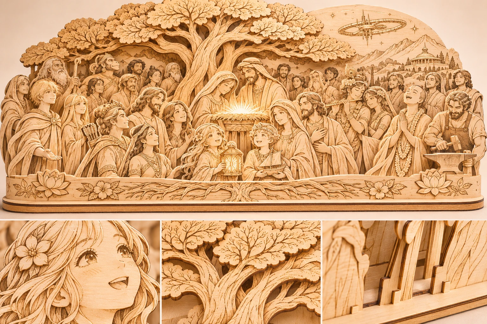

# Dřevěný betlém — návrh V2

**Stav: návrh k dopracování. Nejde o výrobní nebo vypalovací soubory.**

Rozměr přibližně 780 × 240 × 330 mm. Předběžný rozpočet: 16 výrobních A3 + 1 zkušební + 1 rezerva; vše překližka 3 mm. Výřezy siluet a gravírované detaily postav. Finální spotřebu potvrdí nesting.

- [Podrobný návrh](Navrh.md)
- [Materiálový plán (SVG, nikoli řezací kontury)](Materialovy-plan.svg)
- [Stránka v Ateliéru](https://zion-terranova-atelier.sereneteal3.chatgpt.site/betlem/laser-v2)

Další kola: reference jednotlivých postav, gravírovací kresby, konstrukční kontury, nesting a fyzická zkouška.

Přímé zadání uživatele 17. 11. 2026. job_id se nepřidělovalo (nejde o frontu). Ověřeno: build, syntaxe Workeru, pět tras HTTP 200 v lokálním handleru, whitespace. Fyzické testy neproběhly; vizualizace není doklad výroby.

[Galerie obrazových návrhů](galerie/README.md)
