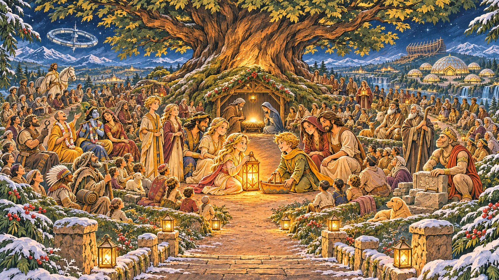
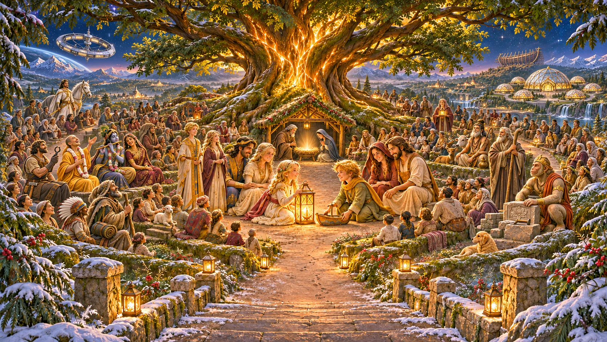
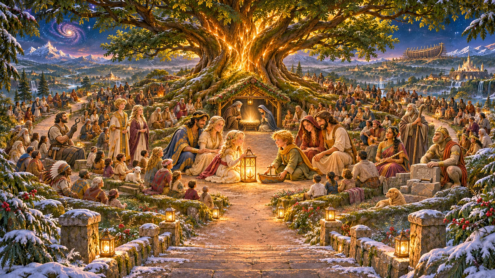
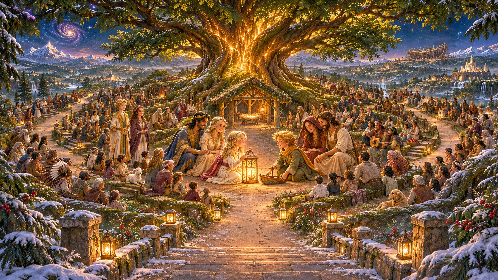

# Obrazové návrhy · Betlém Rodina světla

Čtyři studie digitální scény doplňují vizualizaci dřevěné varianty V2. Starší varianty zachycují vývoj kompozice a v obloze ještě používají motiv galaxie. Pro aktuální scénu platí orbitální Issobella.

[Dřevěná varianta V2](../README.md) · [Galerie v Ateliéru](https://zion-terranova-atelier.sereneteal3.chatgpt.site/betlem/laser-v2#obrazove-navrhy)

## Setkání Lumi a Malého prince

Dvojice dětí a lucerna v popředí. Issobella má v levé části oblohy podobu prstence.

[Původní PNG](https://chatgpt.com/library?file_id=libfile_4167d6fff05c8191aa5e7fdaa5b5743d&account_id=personal)

## Vánoční ZION pod Stromem života

Široký záběr shromážděné rodiny a pohled do údolí.

[Původní PNG](https://chatgpt.com/library?file_id=libfile_2b5361f16d748191b7d9a0cf6fc96915&account_id=personal)

## Zimní betlém

Studie zimní krajiny, světla jeslí a otevřeného příchodu.

[Původní PNG](https://chatgpt.com/library?file_id=libfile_77e5a0ea1bb08191b5fcb6930f14159a&account_id=personal)

## Betlém pod Stromem života

Studie celkové kompozice s rodinným kruhem kolem centrálního stromu.

[Původní PNG](https://chatgpt.com/library?file_id=libfile_bdfba771084c819199e020a31908a676&account_id=personal)
