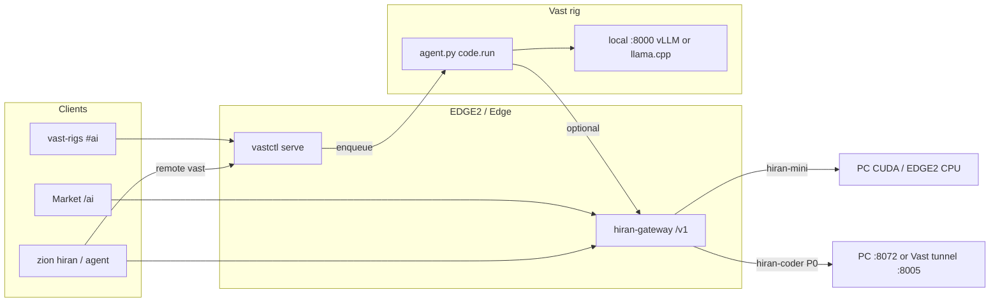

# Hiran Complete Plan — kanonická next mapa

> Stav: **2026-10-29** · root kanon nad dílčími plány.  
> Implementace P0–P4 / FT = samostatné práce; tento soubor = priorita + checklist.

## Související dokumenty (detail)

| Dokument | Role |
|---|---|
| [`docs/3.2/VAST_HIRAN_CODING_AGENT_PLAN.md`](docs/3.2/VAST_HIRAN_CODING_AGENT_PLAN.md) | F0–F3 scaffold (gateway fabric, `code.run`, `#ai`, CLI remote) |
| [`HIRAN-MARKETPLACE-PLAN.md`](HIRAN-MARKETPLACE-PLAN.md) | Rodina modelů, Market F3 listing / F4 provoz |
| [`HIRAN-CLI-AUTH.md`](HIRAN-CLI-AUTH.md) | ZIS device-code, Stripe, MetaMask → plány |
| [`docs/3.2/B2B_HIRAN_AGENT_CLI.md`](docs/3.2/B2B_HIRAN_AGENT_CLI.md) | Local `zion agent` + B2B surface |
| [`VASTAI-MINING.md`](VASTAI-MINING.md) §5 | Vast inference / mining ops |
| [`docs/3.2/B2B_HIRAN_SECRETS.md`](docs/3.2/B2B_HIRAN_SECRETS.md) | Secrets / env (bez hodnot v gitu) |

---

## 1. Cíl produktu

**ZION Hiran + Vast Coding Agent** — hybrid *compose* (neslučovat binárky):

1. **Model fabric** — Hiran gateway (`market…/v1`): aliasy `hiran-mini`, `hiran-coder`, Trinity mockupy → live po FT.
2. **Coding worker** — fleet `agent.py` op `code.run` (tool jail) na rigu; UI `#ai` + CLI `zion hiran agent --remote vast`.
3. **Market surface** — veřejný `/ai` (plány, CLI login, soft-sell); později per-alias listing.

**Auth oddělení (pevné):**

| Klíč | Účel |
|---|---|
| `zis_*` | User LLM metering / gateway turns |
| `VASTCTL_AGENT_TOKEN` / enroll | Fleet control plane (enqueue, heartbeat) — **nikdy** = user API key |

---

## 2. Architektura (cíl)



```
UI / CLI ──enqueue code.run──► vastctl ──heartbeat──► agent.py
agent.py ──tools jail────────► /root/work
agent.py ──chat──────────────► local :8000 | gateway hiran-coder
User chat ──zis_*────────────► gateway ──► mini / coder upstreams
```

---

## 3. Stav snapshot (2026-10-29) — hotovo

### Market / auth

- [x] Market Navbar odkaz **AI** → `/ai` (desktop + mobil)
- [x] Homepage karta **Hiran AI** (`AiSection`)
- [x] `/ai` soft-sell: plány Free/Pro/Team, CLI login, odkaz Vast Coding Agent
- [x] `/ai/cli` device-code approve → mint `zis_*`
- [x] Stripe `hiran-subscribe` + webhook `set_plan`
- [x] MetaMask Base USDC intent/confirm → admin plan
- [x] CLI: `zion hiran login|logout|whoami|subscribe`

### Gateway + local agent

- [x] Gateway MVP `market…/v1` — `hiran-mini` **live**
- [x] Trinity aliasy mockup (`503` / `x-mockup`)
- [x] Slot `hiran-coder` (health zatím `live:false` — viz P0)
- [x] Local `zion agent` tool jail + Hiran client (B2B-3b MVP)

### Vast coding scaffold (F0–F3)

- [x] F0 docs + křížové odkazy
- [x] F1 fabric scaffold (aliasy / models matrix)
- [x] F2 `op=code.run` + `code_run.py` jail + bootstrap scp + unit testy
- [x] F3 `#ai` Coding Agent UI + `zion hiran agent --remote vast`
- [x] Deploy 29.10.: Intro `#ai`, Market soft-sell, vastctl `code-run` endpoints
- [x] E2E **smoke** rig `58077390`: enroll + `code.run` → tool turn + `SMOKE_OK`  
      (LLM = OpenAI **stub** `:8000`; image bez Docker → vLLM skip)

**vast-rigs nav:** záměrně **bez** veřejné AI karty v Intro nav (interní tab `#ai` zůstává).

---

## 4. Zbývající fáze (priorita)

### P0 — `hiran-coder` live (veřejný alias)

**Proč:** Market/CLI routing na coder; slot existuje, upstream ne.

- [ ] Stabilní upstream: prefer PC coder `:8072` (přes proxy) **nebo** Vast tunnel → EDGE2 `:8005`
- [ ] Gateway env / `models` entry — `hiran-coder` v `/v1/models` s `live:true`
- [ ] Health probe zelený; smoke `POST /v1/chat/completions` model=`hiran-coder`
- [ ] Dokumentovat fallback řetěz: vast coder → PC `:8072` → EDGE2 (pokud dostupný)

**Done when:** `GET …/v1/models` ukáže `hiran-coder` live; jeden chat turn OK s `zis_*`.

### P1 — Reálný weight na rigu (ne stub)

**Proč:** Smoke dokázal jail + enqueue; produkt potřebuje GGUF/vLLM.

- [ ] Fleet ≥1 enrolled agent (`VASTCTL_ENROLL_TOKEN` v serve env; bootstrap)
- [ ] Image s **Dockerem** → vLLM pin (`vllm/vllm-openai:v0.8.5` nebo ověřený tag)  
      **nebo** manuální llama.cpp GGUF path (bez Docker)
- [ ] LLM na `127.0.0.1:8000` (`VASTCTL_AI_PORT` / `VAST_AGENT_LLM_URL`)
- [ ] E2E `code.run` s reálným modelem (tool turn + smysluplná odpověď)
- [ ] Mining vs infer: sheet / dočasný stop mine při code burst (contention — viz rizika)

**Done when:** E2E checklist z Vast plánu §7 splněn **bez** stub serveru.

### P2 — Remote metering přes gateway

**Proč:** Remote dnes jede na fleet token + local `:8000`; user billing musí jít přes `zis_*`.

- [ ] Worker / remote path: LLM calls přes gateway (`hiran-coder` / `hiran-mini`) s user turn budget
- [ ] Žádný user `llm_key` v enqueue args z control plane (už deny — držet)
- [ ] CLI remote: meterované turns viditelné ve `whoami` / usage
- [ ] Fail-closed při vyčerpání plánu

**Done when:** remote `code.run` odečte turns na ZIS/Hiran plánu, ne jen ops token.

### P3 — Market F3 listing

**Proč:** `/ai` je pricing + soft-sell; chybí katalog aliasů jako produkt.

- [ ] Karta per alias: params, ctx, $/1M tok (gpu$/h ÷ tok/s × marže), live dostupnost
- [ ] Zdroj dostupnosti: `model_endpoints()` / gateway health
- [ ] Trial chat widget (rate-limited, `zis_*` nebo guest trial)
- [ ] Settlement copy: ZION/L2 (dry-run flag dokud není produkční settlement)
- [ ] Rozhodnutí copy: přímý prodej inference vs „Hiran inside“ badge (Marketplace §5)

**Done when:** `/ai` (nebo podstránka) ukáže live karty mini (+ coder když P0) s cenou a CTA.

### P4 — Provoz / observabilita

- [ ] `inference_live` (nebo ekvivalent) do G8 / Prometheus
- [ ] Uptime badge z `ai_status` historie (vast-rigs / Market)
- [ ] Stabilní fallback: hiran-core (PC) → EDGE2 CPU → Vast
- [ ] Alert při `hiran-coder`/`hiran-mini` down > N minut
- [ ] SMOS 518837: opravit rotaci **nebo** oficiálně retire (Marketplace open item)

**Done when:** ops má gauge + alert; veřejný badge sedí s realitou.

### FT — Trinity train-first (paralelní / odložené)

> Neblokuje P0–P2 scaffold. Zvedá *kvalitu* ZION znalosti a Issobella jako default coder.

Pořadí: shared constitution → **Maitreya** → **Amitábha** → **Issobella**.

- [ ] Dataset pack: `docs/` + canon allowlist + ops FAQ (**licence** — blokuje veřejný GGUF)
- [ ] Eval suite „ZION komplexně“ (20–50 Q) ≥ baseline `hiran-mini`
- [ ] QLoRA smoke per persona na Vast (reuse HiranDev / v2.3 recept)
- [ ] Export GGUF Q4/Q5 → mockup→`live` v `#ai` + gateway
- [ ] Po Issobella live: `hiran-coder` default = Issobella; Trinity picker v `#ai`

**Done when:** aspoň jedna persona mockup→live + eval pass nad mini baseline.

---

## 5. Ops prerekvizity (checklist)

| Položka | Poznámka |
|---|---|
| `VASTCTL_ENROLL_TOKEN` | Musí být v env `vastctl serve` (jinak enroll 403) |
| `VASTCTL_AGENT_TOKEN` | Enqueue / fleet mutations |
| Rent GPU | Fleet=0 → žádný remote coding |
| Docker na rigu | Jinak vLLM skip → llama.cpp manuálně |
| PC tunnel chain | mini primary; coder P0 přes `:8072` / `:8005` |
| Gateway deploy | `scripts/ops/deploy-hiran-gateway.sh` + systemd `zion-hiran-gateway` |

---

## 6. Success criteria (produkt „complete“ pro tuto mapu)

- [ ] P0: `hiran-coder` live na public `/v1`
- [ ] P1: E2E `code.run` s reálným weightem
- [ ] P2: remote turns metered `zis_*`
- [ ] P3: Market listing karty + trial
- [ ] P4: inference v monitoringu + fallback
- [ ] FT (aspoň 1 persona): mockup→live (může doběhnout po P0–P2)

---

## 7. Out of scope

- Auto-rent Vast nabídek pro coding
- Multi-GPU / tensor parallel napříč rigy
- Merge `agent.py` ↔ `zion agent` do jednoho binárního produktu
- Aider / OpenHands jako default workload
- Public/archive CLI packaging jako samostatný release (zatím V31 operator CLI)
- Nahrazení Maestro / ai-native
- L1 consensus změny

---

## 8. Rizika

- VRAM contention mining ↔ inference (duty / sheet nutný při P1)
- Image bez Docker = jen stub nebo ruční llama.cpp
- Floating `latest` vLLM — po smoke pinnout tag
- Gated HF váhy bez tokenu = deploy 401
- Licence korpusu blokuje FT Maitreya / veřejný GGUF
- Edge sshd / fail2ban — ops enroll citlivý na rychlé SSH

---

## 9. Soubory implementace

| Vrstva | Cesty |
|---|---|
| Market UI | `apps/MarketPlace/src/app/ai/`, `components/Navbar.tsx`, `components/sections/AiSection.tsx` |
| Intro `#ai` | `apps/IntroPage/src/app/vast-rigs/Dashboard.tsx` |
| Gateway | `V31/L3/hiran-gateway/` (`models.rs`, `proxy.rs`, `routes.rs`) |
| CLI | `V31/cli/src/agent/`, `commands/hiran.rs`, `commands/agent.rs` |
| Fleet | `infra/tools/vast/{vastctl.py,agent.py,code_run.py,bootstrap-agent.sh,zion-coder-job.sh}` |
| Deploy | `apps/MarketPlace/deploy/deploy-marketplace.sh`, `scripts/ops/deploy-hiran-gateway.sh` |

---

## 10. Doporučené pořadí práce

1. **P0** coder upstream (nejrychlejší user-visible win na Market/CLI)  
2. **P1** reálný rig weight + E2E  
3. **P2** metering (billing integrity)  
4. **P3** Market listing  
5. **P4** monitoring  
6. **FT** Trinity paralelně, jakmile je licence/dataset ready  

*Konec kanonické mapy — detaily fází zůstávají v dílčích plánech výše.*
